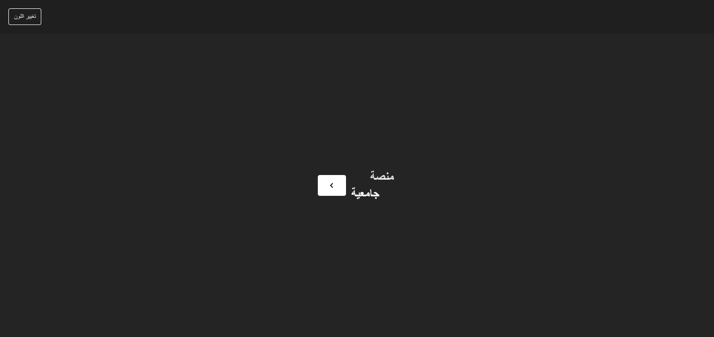
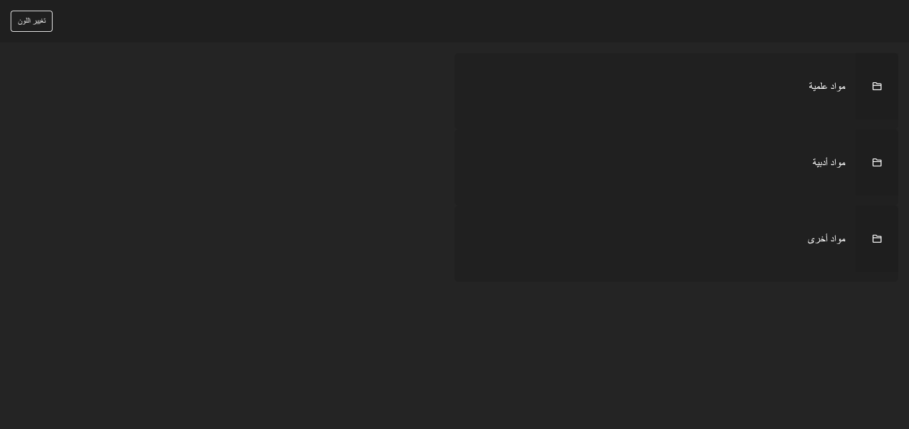
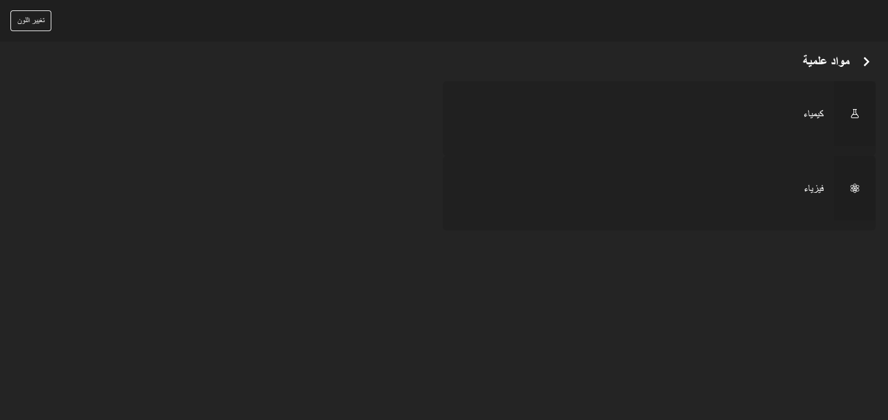
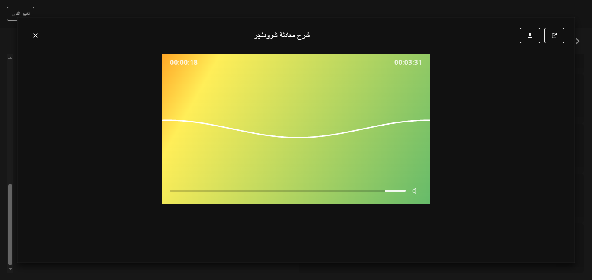
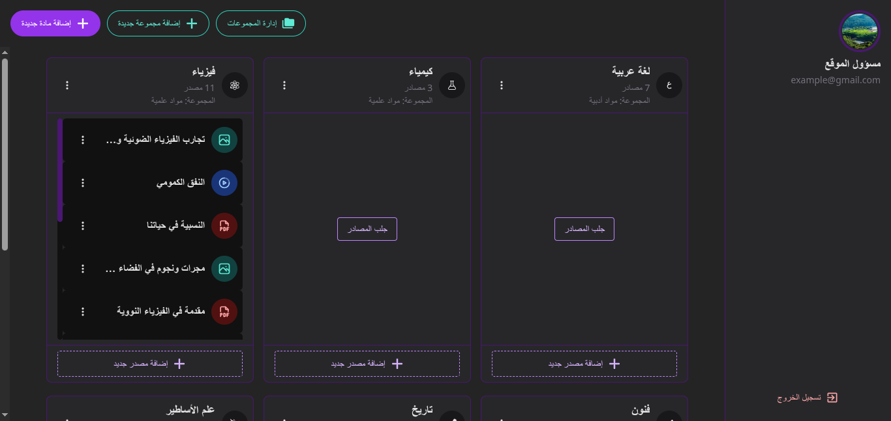
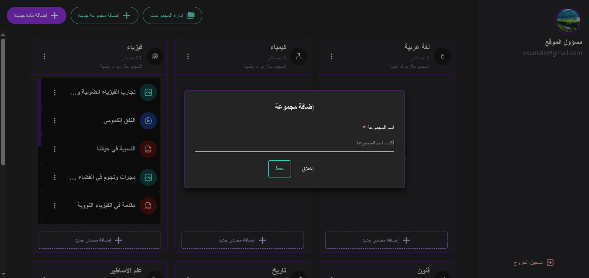
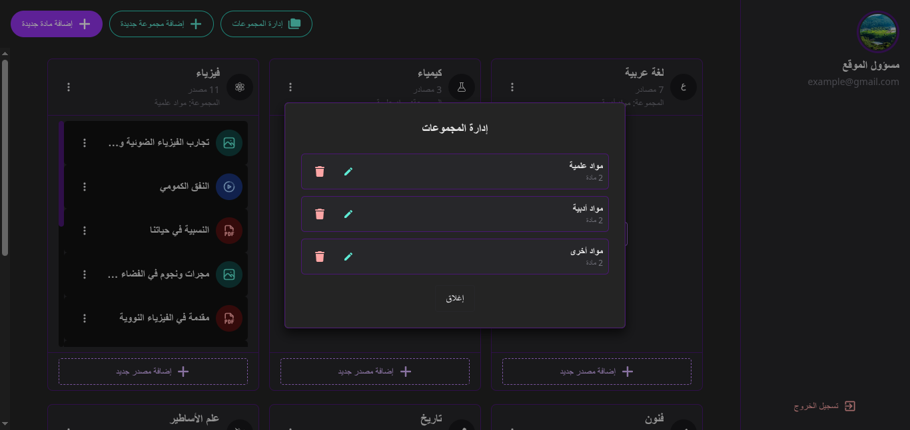
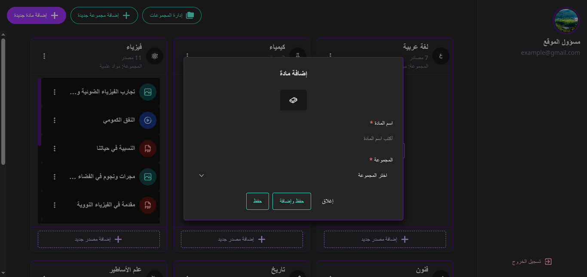
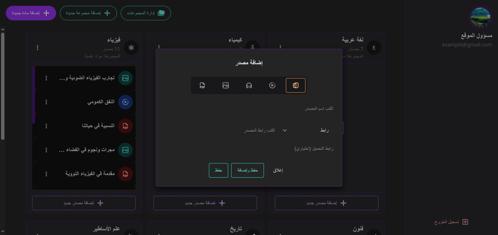

<br>

<!-- ═══════════════════════════════════════════════════════════════════════════ -->
<!--                              HEADER BLOCK                                -->
<!-- ═══════════════════════════════════════════════════════════════════════════ -->

<p align="center">
  <a href="https://github.com/HBI-Developer/subjects-platform">
    
  </a>
</p>

<h1 align="center">Subjects Platform</h1>
<h3 align="center">منصة جامعية</h3>

<p align="center">
  A modern educational platform built with React and Firebase for organizing and delivering academic subjects and digital resources.
  <br>
  <a href="#-getting-started"><strong>🚀 Getting Started</strong></a>
  &nbsp;·&nbsp;
  <a href="#-features"><strong>✨ Features</strong></a>
  &nbsp;·&nbsp;
  <a href="#-architecture"><strong>🏗️ Architecture</strong></a>
  &nbsp;·&nbsp;
  <a href="#-contributing"><strong>🤝 Contributing</strong></a>
</p>

<br>

<!-- ═══════════════════════════════════════════════════════════════════════════ -->
<!--                              BADGES                                      -->
<!-- ═══════════════════════════════════════════════════════════════════════════ -->

<p align="center">
  <a href="https://github.com/HBI-Developer/subjects-platform/blob/main/LICENSE.txt">
    
  </a>
  
  
  
  
  
  
</p>

<br>

---

<br>

<!-- ═══════════════════════════════════════════════════════════════════════════ -->
<!--                         TABLE OF CONTENTS                                -->
<!-- ═══════════════════════════════════════════════════════════════════════════ -->

## 📑 Table of Contents

- [Overview](#-overview)
- [Features](#-features)
- [Screenshots](#-screenshots)
- [Architecture](#-architecture)
- [Tech Stack](#-tech-stack)
- [Requirements](#-requirements)
- [Getting Started](#-getting-started)
- [Available Scripts](#-available-scripts)
- [Data Model](#-data-model)
- [Firebase Configuration](#-firebase-configuration)
- [Deployment](#-deployment)
- [Code Quality](#-code-quality)
- [Project Status](#-project-status)
- [Contributing](#-contributing)
- [License](#-license)
- [React Compiler](#-react-compiler)

<br>

---

<br>

<!-- ═══════════════════════════════════════════════════════════════════════════ -->
<!--                            OVERVIEW                                      -->
<!-- ═══════════════════════════════════════════════════════════════════════════ -->

## 🔭 Overview

**Subjects Platform** is a right-to-left (RTL) React web application designed for browsing academic subjects and educational resources in a smooth and organized manner. The application integrates with Firebase to provide a cloud database, secure authentication, and reliable hosting.

<br>

The application follows a simple and organized navigation flow:

```
🏠 Welcome
  └── 📚 Collections
        └── 📖 Subjects
              └── 📦 Resources
                    ├── 📄 PDF
                    ├── 🖼️ Images
                    ├── 🎵 Audio
                    ├── 🎬 Video
                    └── 📊 Microsoft Office Files
```

Content is stored in **Cloud Firestore**. Public pages display published content, while authenticated administrators can create, update, and delete collections, subjects, and resources from the protected dashboard.

<br>

---

<br>

<!-- ═══════════════════════════════════════════════════════════════════════════ -->
<!--                             FEATURES                                     -->
<!-- ═══════════════════════════════════════════════════════════════════════════ -->

## ✨ Features

### 📋 Content Management

| Feature | Description |
| :---: | :--- |
| **Full CRUD** | Create, edit, and delete collections, subjects, and resources |
| **Smart Organization** | Link subjects to collections and move them to the orphan collection when the parent collection is deleted |
| **Chronological Ordering** | Order all items by creation time |
| **Browser Caching** | Cache collection and subject reads in the browser to reduce repeated requests |
| **Virtual Scrolling** | Improve dashboard performance with virtual scrolling for large lists |
| **Live Updates** | Real-time updates between administrators using Firestore Realtime |

---

### 📦 Resource Delivery

| Feature | Description |
| :---: | :--- |
| **Multiple Types** | Support for PDF, images, audio, video, and Microsoft Office files |
| **Built-in Viewers** | Render resources in dedicated viewers including EmbedPDF and an Office viewer |
| **Video Playback** | Playback via Video.js with ReactPlayer support for indirect or platform-hosted links |
| **Link Processing** | Parse and validate direct URLs, Google Drive file URLs, and Internet Archive URLs |
| **Internet Archive** | Resolve compatible files from Internet Archive metadata |

---

### 🎨 User Experience

| Feature | Description |
| :---: | :--- |
| **RTL Design** | Right-to-left interface designed for Arabic educational content |
| **Dynamic Colors** | Chakra UI components with the ability to change the entire app's theme color |
| **Protected Routes** | Protected admin route with authentication state handling |
| **Smooth Experience** | Loading overlays, toast notifications, error boundaries, and a custom 404 page |

<br>

---

<br>

<!-- ═══════════════════════════════════════════════════════════════════════════ -->
<!--                           SCREENSHOTS                                    -->
<!-- ═══════════════════════════════════════════════════════════════════════════ -->

## 📸 Screenshots

  <p align="center">
    
    <br>
    <em>Welcome Page</em>
  </p>

  <p align="center">
    
    <br>
    <em>Collections Page</em>
  </p>

  <p align="center">
    
    <br>
    <em>Subjects Page</em>
  </p>

  <p align="center">
    
    <br>
    <em>Audio Resource</em>
  </p>

  <p align="center">
    
    <br>
    <em>Admin Dashboard</em>
  </p>

  <p align="center">
    
    <br>
    <em>Add Collection</em>
  </p>

  <p align="center">
    
    <br>
    <em>Manage Collections</em>
  </p>

  <p align="center">
    
    <br>
    <em>Add Subject</em>
  </p>

  <p align="center">
    
    <br>
    <em>Add Resource</em>
  </p>

<br>

---

<br>

<!-- ═══════════════════════════════════════════════════════════════════════════ -->
<!--                           ARCHITECTURE                                   -->
<!-- ═══════════════════════════════════════════════════════════════════════════ -->

## 🏗️ Architecture

The project is organized around feature pages, reusable UI components, Firebase access helpers, and a small Redux store:

```
subjects-platform/
│
├── 📁 src/
│   ├── 📁 pages/               # Application pages
│   │   ├── welcome/            # Welcome page
│   │   ├── collections/        # Collections view
│   │   ├── subjects/           # Subjects view
│   │   ├── resources/          # Resources view
│   │   ├── resource/           # Single resource viewer (Lazy-loaded)
│   │   ├── dashboard/          # Admin dashboard
│   │   │   └── components/     # Dashboard components
│   │   ├── login/              # Login page
│   │   └── page404/            # 404 page
│   │
│   ├── 📁 components/          # Shared components
│   │   ├── audioplayer/        # Audio player
│   │   ├── videoplayer/        # Video player (Video.js)
│   │   ├── pdfviewer/          # PDF viewer (EmbedPDF)
│   │   ├── officeviewer/       # Office file viewer
│   │   ├── carousel/           # Image carousel
│   │   ├── panel/              # Display panel
│   │   ├── page/               # Page wrapper with transitions
│   │   ├── protectedroute/     # Admin route protection
│   │   ├── errorboundary/      # Error boundaries
│   │   ├── errormessage/       # Error messages
│   │   ├── switch/             # Switch component
│   │   ├── virtualpanellist/   # Virtual lists
│   │   └── ui/                 # Custom Chakra UI components
│   │
│   ├── 📁 functions/           # Firestore queries and navigation helpers
│   ├── 📁 helpers/             # URL detection, resource normalization, and validation
│   ├── 📁 hooks/               # Custom React Hooks
│   ├── 📁 store/               # Redux Toolkit (global state)
│   │   └── slice/              # Slices: color, scope, loading, identifier
│   ├── 📁 assets/              # Static assets
│   ├── app.tsx                 # Application shell and page flow
│   ├── main.tsx                # Entry point and routing
│   ├── firebase-config.ts      # Firebase initialization with caching
│   └── constants.ts            # Application constants
│
├── 📁 functions/               # Firebase Cloud Functions
│   └── src/index.ts
│
├── 📁 scripts/                 # Helper scripts (data seeding/fetching)
├── 📁 data/                    # Development data
├── 📁 public/                  # Public assets (logo.svg)
│
├── firebase.json               # Firebase configuration
├── firestore.rules             # Firestore security rules
├── firestore.indexes.json      # Composite indexes
├── vite.config.ts              # Vite configuration
├── biome.json                  # Biome configuration (Linter & Formatter)
├── knip.json                   # Knip configuration (unused code)
├── stryker.conf.json           # Mutation testing configuration
├── sonar-project.properties    # SonarQube configuration
├── tsconfig.json               # TypeScript configuration
└── package.json                # Project dependencies and scripts
```

<br>

---

<br>

<!-- ═══════════════════════════════════════════════════════════════════════════ -->
<!--                          TECH STACK                                      -->
<!-- ═══════════════════════════════════════════════════════════════════════════ -->

## 🛠️ Tech Stack

<br>

<table align="center">
  <thead>
    <tr>
      <th align="center">Area</th>
      <th align="center">Technology</th>
    </tr>
  </thead>
  <tbody>
    <tr>
      <td><strong>⚛️ Application</strong></td>
      <td>React 19 · TypeScript 5.9 · Vite 7</td>
    </tr>
    <tr>
      <td><strong>🗺️ Routing</strong></td>
      <td>React Router 7</td>
    </tr>
    <tr>
      <td><strong>🎨 UI</strong></td>
      <td>Chakra UI 3 · Sass · Iconify · React Icons</td>
    </tr>
    <tr>
      <td><strong>📦 State</strong></td>
      <td>Redux Toolkit · React Redux</td>
    </tr>
    <tr>
      <td><strong>☁️ Backend</strong></td>
      <td>Firebase Authentication · Firestore · Hosting · Cloud Functions</td>
    </tr>
    <tr>
      <td><strong>📄 Documents</strong></td>
      <td>EmbedPDF</td>
    </tr>
    <tr>
      <td><strong>🎬 Media</strong></td>
      <td>Video.js · ReactPlayer · Embla Carousel</td>
    </tr>
    <tr>
      <td><strong>🧰 Tooling</strong></td>
      <td>pnpm · Biome · Knip · Vitest · Stryker · SonarQube</td>
    </tr>
  </tbody>
</table>

<br>

---

<br>

<!-- ═══════════════════════════════════════════════════════════════════════════ -->
<!--                          REQUIREMENTS                                    -->
<!-- ═══════════════════════════════════════════════════════════════════════════ -->

## 📋 Requirements

| Requirement | Version |
| :---: | :---: |
| Node.js | 24+ |
| pnpm | Latest |
| Firebase | A project with Authentication and Firestore enabled |

<br>

---

<br>

<!-- ═══════════════════════════════════════════════════════════════════════════ -->
<!--                         GETTING STARTED                                  -->
<!-- ═══════════════════════════════════════════════════════════════════════════ -->

## 🚀 Getting Started

### 1️⃣ Install Dependencies

```bash
pnpm install
```

### 2️⃣ Configure Firebase

Create a local environment file from the provided template:

```bash
cp .env.example .env
```

Set the following Firebase values in your `.env` file:

```dotenv
VITE_API_KEY="your-firebase-api-key"
VITE_AUTH_DOMAIN="your-project.firebaseapp.com"
VITE_PROJECT_ID="your-project-id"
VITE_STORAGE_BUCKET="your-project.appspot.com"
VITE_MESSAGING_SENDER_ID="your-sender-id"
VITE_APP_ID="your-app-id"
```

### 3️⃣ Start the Development Server

```bash
pnpm dev
```

The application is served by Vite. Use `pnpm preview` to preview a production build locally.

<br>

---

<br>

<!-- ═══════════════════════════════════════════════════════════════════════════ -->
<!--                        AVAILABLE SCRIPTS                                 -->
<!-- ═══════════════════════════════════════════════════════════════════════════ -->

## ⚡ Available Scripts

| Script | Description |
| :--- | :--- |
| `pnpm dev` | 🟢 Start the Vite development server |
| `pnpm build` | 📦 Type-check and build the production bundle |
| `pnpm preview` | 👁️ Preview the production bundle |
| `pnpm lint` | 🔍 Run Biome checks |
| `pnpm lint:fix` | 🔧 Apply Biome fixes automatically |
| `pnpm format` | ✏️ Format the source tree with Biome |
| `pnpm knip` | 🗑️ Detect unused files and dependencies |
| `pnpm check` | ✅ Run Biome and Knip together |
| `pnpm exec vitest run` | 🧪 Run the Vitest test suite |
| `pnpm deploy:hosting` | 🚀 Build and deploy Hosting only |
| `pnpm deploy` | 🌐 Build and deploy Hosting and Firestore |

<br>

---

<br>

<!-- ═══════════════════════════════════════════════════════════════════════════ -->
<!--                          DATA MODEL                                      -->
<!-- ═══════════════════════════════════════════════════════════════════════════ -->

## 🗃️ Data Model

The primary Firestore collections are:

<br>

```
┌─────────────────────────────────────────────────────────┐
│                    Cloud Firestore                       │
├─────────────────────────────────────────────────────────┤
│                                                         │
│  📚 collections                                         │
│  ├── id: string                                         │
│  ├── title: string                                      │
│  ├── createdTime: number                                │
│  └── relatedSubjects: number                            │
│                                                         │
│  📖 subjects                                            │
│  ├── id: string                                         │
│  ├── icon: string                                       │
│  ├── title: string                                      │
│  ├── createdTime: number                                │
│  ├── belongToId: string ──── → collections.id           │
│  └── relatedResources: number                           │
│                                                         │
│  📦 resources                                           │
│  ├── id: string                                         │
│  ├── type: "pdf" | "images" | "audio" | "video"         │
│  │         | "office"                                   │
│  ├── title: string                                      │
│  ├── resources: string[]                                │
│  └── createdTime: number                                │
│                                                         │
│  🔐 admins                                              │
│  └── email: string                                      │
│                                                         │
└─────────────────────────────────────────────────────────┘
```

<br>

> [!IMPORTANT]
> The reserved orphan collection ID is `00000000000000000000`. It keeps subjects available when their parent collection is deleted.

<br>

---

<br>

<!-- ═══════════════════════════════════════════════════════════════════════════ -->
<!--                      FIREBASE CONFIGURATION                              -->
<!-- ═══════════════════════════════════════════════════════════════════════════ -->

## 🔥 Firebase Configuration

Firebase configuration is maintained in the repository root:

| File | Description |
| :--- | :--- |
| [`firebase.json`](firebase.json) | Hosting, Functions, Firestore, and emulator configuration |
| [`firestore.rules`](firestore.rules) | Firestore access rules |
| [`firestore.indexes.json`](firestore.indexes.json) | Composite indexes for ordered queries |
| [`functions/`](functions) | Cloud Functions package and source |

<br>

**Emulator Ports:**

| Service | Port |
| :---: | :---: |
| 🌐 Hosting | `5000` |
| ⚙️ Functions | `5001` |
| 🗄️ Firestore | `8888` |
| 🔐 Authentication | `9099` |
| 🖥️ Emulator UI | `6061` |

<br>

> [!NOTE]
> Hosting rewrites all routes to `index.html` so client-side React navigation works after deployment.

<br>

---

<br>

<!-- ═══════════════════════════════════════════════════════════════════════════ -->
<!--                           DEPLOYMENT                                     -->
<!-- ═══════════════════════════════════════════════════════════════════════════ -->

## 🌐 Deployment

**Deploy Hosting only:**

```bash
pnpm deploy:hosting
```

**Deploy Hosting together with Firestore rules and indexes:**

```bash
pnpm deploy
```

> Firebase runs the Functions build during deployment according to [`firebase.json`](firebase.json).

<br>

---

<br>

<!-- ═══════════════════════════════════════════════════════════════════════════ -->
<!--                         CODE QUALITY                                     -->
<!-- ═══════════════════════════════════════════════════════════════════════════ -->

## 🔬 Code Quality

The project uses an integrated set of code quality tools:

<br>

| Tool | Purpose |
| :---: | :--- |
| **Biome** | Single formatter and linter for the codebase |
| **Knip** | Detect unused code and dependencies |
| **Vitest** | Testing framework |
| **Stryker** | Mutation testing |
| **SonarQube** | Static code analysis |

<br>

**Before opening any change, run:**

```bash
pnpm check
pnpm build
```

<br>

---

<br>

<!-- ═══════════════════════════════════════════════════════════════════════════ -->
<!--                        PROJECT STATUS                                    -->
<!-- ═══════════════════════════════════════════════════════════════════════════ -->

## 📊 Project Status

The current implementation includes:

- [x] Full CRUD workflows for collections, subjects, and resources in the dashboard
- [x] Google Drive and Internet Archive link handling
- [x] Microsoft Office resource support
- [x] Migration from Plyr to Video.js
- [x] Improved PDF, image, audio, video, and Office viewing flows
- [x] Lowercase file and directory naming throughout the source tree
- [x] Virtual scrolling in the dashboard
- [x] Live updates between administrators (It has not been tested.)
- [x] Counter Field usage instead of Aggregation Queries
- [x] Firestore caching via IndexedDB

<br>

---

<br>

<!-- ═══════════════════════════════════════════════════════════════════════════ -->
<!--                          CONTRIBUTING                                    -->
<!-- ═══════════════════════════════════════════════════════════════════════════ -->

## 🤝 Contributing

Contributions and focused improvements are welcome. To contribute:

1. Create a feature branch from `main`
2. Keep changes focused and follow the existing TypeScript and Biome conventions
3. Run `pnpm check` and `pnpm build` before submitting a pull request
4. Describe the user-facing change and any Firebase configuration changes in the pull request

<br>

---

<br>

<!-- ═══════════════════════════════════════════════════════════════════════════ -->
<!--                            LICENSE                                       -->
<!-- ═══════════════════════════════════════════════════════════════════════════ -->

## 📄 License

This project is licensed under the [Apache License 2.0](LICENSE.txt).

<br>

---

<br>

<!-- ═══════════════════════════════════════════════════════════════════════════ -->
<!--                          REACT COMPILER                                  -->
<!-- ═══════════════════════════════════════════════════════════════════════════ -->

## ⚛️ React Compiler

The React Compiler is not enabled because of its impact on development and build performance. To enable it, see the [React Compiler documentation](https://react.dev/learn/react-compiler/installation).

<br>

---

<p align="center">
  Made with <span title="Tea">🫖</span> by <a href="https://github.com/HBI-Developer">HBI-Developer</a>
</p>
